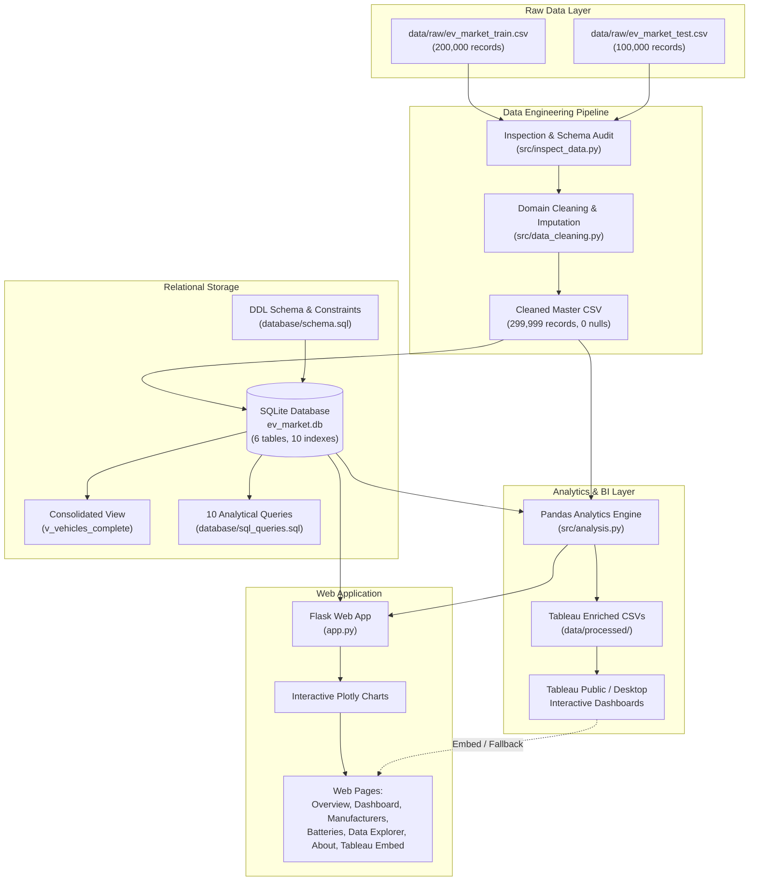

# Electric Vehicle Market Performance & Insights

An end-to-end individual data analytics, database engineering, and business intelligence portfolio project analyzing global electric vehicle (EV) market trends, automaker competitiveness, battery chemistry performance, driving ranges, and consumer sentiment across **299,999 vehicle configurations**.

Developed as a B.Tech Artificial Intelligence and Data Science capstone portfolio project suitable for mentor evaluation, GitHub submission, and live interactive demonstrations.

---

## 1. Project Overview & Problem Statement

The rapid acceleration of the electric vehicle industry has transformed global automotive manufacturing, supply chain dynamics, and regulatory landscapes. However, commercial decision-makers, fleet managers, and automotive analysts face challenges evaluating:
- Manufacturer market share and portfolio depth across diverse segments.
- Real-world performance trade-offs between battery chemistries (LFP vs NMC vs Solid-State vs Sodium-Ion).
- Affordability benchmarks and cost per kilometer of driving range.
- Regional assembly concentration and global demand distributions.

This solution provides an empirical, data-driven analytics platform answering these strategic questions through **normalized relational SQL storage**, **modular Pandas analytical engines**, an **interactive Flask + Plotly web application**, and **Tableau Public BI integration**.

---

## 2. Technology Stack

| Layer | Technology | Purpose |
|:---|:---|:---|
| **Core Language** | Python 3.10+ (Tested on Python 3.14) | Core scripting, pipeline orchestration, and analysis |
| **Data Processing** | Pandas, NumPy | Data cleaning, domain median imputation, and aggregations |
| **Relational Database** | SQLite 3 | Normalized 3NF storage, constraints, indexes, and SQL analytics |
| **Web Framework** | Flask 3.1+ | Responsive web server and API endpoints |
| **Interactive Visuals**| Plotly (Python) & Plotly.js | Interactive charts with custom dark theme integration |
| **Frontend UI** | HTML5, Modern CSS3, JavaScript | Responsive layout, modern KPI cards, and data explorer |
| **Business Intelligence**| Tableau Public / Tableau Desktop | Interactive dashboards, visual stories, and CSV feeds |
| **Testing & Quality** | Pytest | 29 automated unit and regression test cases |
| **Version Control** | Git & GitHub | Modular commits, documentation, and reproducibility |

---

## 3. Solution Architecture



---

## 4. Project Directory Structure

```text
Electric Vehicle Market Performance & Insights/
├── app.py                     # Flask web application with Plotly integration
├── config.py                  # Central configuration & path management
├── requirements.txt           # Project dependencies
├── pytest.ini                 # Pytest configuration settings
├── .gitignore                 # Git ignore rules for Python, DB & cache
├── README.md                  # Comprehensive portfolio documentation
├── data/
│   ├── raw/                   # Preserved original CSV datasets
│   │   ├── ev_market_train.csv
│   │   └── ev_market_test.csv
│   └── processed/             # Cleaned & Tableau-ready CSV exports
│       ├── electric_vehicles_cleaned.csv
│       ├── ev_market_train_cleaned.csv
│       ├── ev_market_test_cleaned.csv
│       ├── ev_tableau_export.csv
│       ├── tableau_manufacturer_kpis.csv
│       ├── tableau_category_kpis.csv
│       ├── tableau_battery_kpis.csv
│       ├── tableau_yearly_trends.csv
│       └── tableau_country_kpis.csv
├── database/
│   ├── schema.sql             # 3NF SQLite schema DDL (tables, indexes, view)
│   ├── sql_queries.sql        # 10 core analytical SQL queries
│   └── ev_market.db           # Relational SQLite database (~186 MB)
├── src/
│   ├── inspect_data.py        # Schema verification & overlap auditor
│   ├── data_cleaning.py       # Cleaning, deduplication & median imputation
│   ├── database_setup.py      # SQLite loader & foreign key validator
│   ├── run_sql_queries.py     # CLI runner for analytical SQL queries
│   └── analysis.py            # Object-oriented Pandas analytics engine
├── templates/                 # Jinja2 HTML5 responsive web templates
│   ├── base.html              # Base layout with navigation and footer
│   ├── index.html             # Project overview & high-level KPI cards
│   ├── dashboard.html         # Interactive Plotly market dashboard & filters
│   ├── manufacturers.html     # Automaker competitiveness & market shares
│   ├── batteries.html         # Battery chemistry & degradation benchmarks
│   ├── data_explorer.html     # SQL-backed search & paginated vehicle table
│   ├── tableau_embed.html     # Tableau Public embed with fallback guide
│   └── about.html             # Academic scope, methodology & author profile
├── static/
│   └── css/
│       └── style.css          # Modern dark-mode responsive design system
├── reports/
│   ├── data_dictionary.md     # Full 38-column specification & valid domains
│   ├── data_profiling_report.md # Data audit, overlap check & quality metrics
│   └── insights_report.md     # Formal executive business intelligence report
└── tests/
    ├── test_environment.py    # Environment & dependency sanity checks
    ├── test_data_cleaning.py   # Cleaning, deduplication & null audits
    ├── test_database.py       # Schema, foreign keys & SQL query checks
    ├── test_analysis.py       # KPI parity & Pandas analytics checks
    └── test_webapp.py         # Flask route tests, Plotly rendering & explorer
```

---

## 5. Installation and Setup (Windows / macOS / Linux)

### Step 1: Clone or Open the Repository
```powershell
cd "Electric Vehicle Market Performance & Insights"
```

### Step 2: Set Up Virtual Environment (Recommended)
```powershell
python -m venv venv
.\venv\Scripts\Activate.ps1
```

### Step 3: Install Dependencies
```powershell
pip install -r requirements.txt
```

---

## 6. Execution & Verification Workflow

### Step 1: Clean and Prepare Datasets
Processes raw data, removes duplicate records, applies domain median imputation, and outputs clean CSVs:
```powershell
python src/data_cleaning.py
```

### Step 2: Initialize SQLite Relational Database
Builds `database/ev_market.db`, applies 3NF schema, populates all 299,999 records, and verifies foreign keys:
```powershell
python src/database_setup.py
```

### Step 3: Run Analytical SQL Queries
Executes all 10 analytical queries and displays formatted outputs with execution runtimes:
```powershell
python src/run_sql_queries.py
```

### Step 4: Run Pandas Analytics & Generate Tableau Exports
Calculates KPIs and exports all 6 Tableau-ready CSV files into `data/processed/`:
```powershell
python src/analysis.py
```

### Step 5: Launch the Flask Web Application
Starts the local development server:
```powershell
python app.py
```
Open your web browser and navigate to:
```text
http://127.0.0.1:5000
```

---

## 7. Web Application Features

1. **Overview Page (`/`):** Executive KPI cards, solution architecture, and fast navigation to analytical modules.
2. **Market Dashboard (`/dashboard`):** Category comparisons (sales vs MSRP), regional sales distribution, driving range vs price scatter plots, and annual fleet evolution with dropdown category filtering.
3. **Manufacturer Analysis (`/manufacturers`):** Top 15 automakers by sales, market share donut chart, and a comprehensive 50-OEM benchmark table.
4. **Battery Technology (`/batteries`):** Cell chemistry distribution, 5-year degradation vs cycle life comparison, DC fast charging duration, and battery cost per km of range.
5. **Data Explorer (`/explorer`):** High-speed, SQL-backed interactive explorer with model search, category and chemistry filters, sorting, and pagination (25 records/page).
6. **Tableau Integration (`/tableau`):** Active embed viewer if `TABLEAU_EMBED_URL` is configured, or an interactive step-by-step guidance card explaining how to connect and publish the Tableau workbook.
7. **About Page (`/about`):** Detailed documentation of academic scope, technology stack, and report references.

---

## 8. Tableau BI Connection & Instructions

The project exports pre-engineered CSV files in `data/processed/`:
- **Master Dataset:** `data/processed/ev_tableau_export.csv` (contains calculated fields: `price_tier`, `range_tier`, `cost_per_km_range`, `power_to_weight_ratio`, and `fast_charge_rate_km_per_min`).
- **Aggregated Summaries:** `tableau_manufacturer_kpis.csv`, `tableau_category_kpis.csv`, `tableau_battery_kpis.csv`, `tableau_yearly_trends.csv`, and `tableau_country_kpis.csv`.

### Step-by-Step Tableau Instructions:
1. Open **Tableau Desktop** or **Tableau Public**.
2. Click **Connect to Data → Text File** and select `data/processed/ev_tableau_export.csv`.
3. Construct the 3 recommended story scenes:
   - **Scene 1 (Market Overview):** Executive KPI cards and category sales distribution.
   - **Scene 2 (Manufacturer Competitiveness):** Automaker sales volume, revenue, and market share.
   - **Scene 3 (Battery Technology & Longevity):** Cell chemistry adoption, degradation rates, and range vs price.
4. Click **Server → Tableau Public → Save to Tableau Public**.
5. Copy your published dashboard URL and set the environment variable:
   ```powershell
   $env:TABLEAU_EMBED_URL="https://public.tableau.com/views/..."
   ```

---

## 9. Automated Testing

The project includes an automated test suite comprising **29 unit and integration tests** covering all modules:

```powershell
pytest
```

**Test Coverage Summary:**
- `tests/test_environment.py`: Verifies Python 3.10+, library imports, and folder structure.
- `tests/test_data_cleaning.py`: Audits row counts, zero missing values, unique vehicle IDs, and domain boundaries.
- `tests/test_database.py`: Validates table counts, foreign keys (`0 violations`), primary key duplicate rejection, and `CHECK` constraints.
- `tests/test_analysis.py`: Asserts 100% numerical parity between Pandas calculations and SQLite queries.
- `tests/test_webapp.py`: Tests all 7 Flask web routes, Plotly JSON serializations, explorer pagination, and Tableau fallback.

---

## 10. Key Insights & Limitations

### Key Findings:
- **Intense Automaker Competition:** No single OEM holds a monopoly; top brands hold ~0.55%–0.59% market share across diverse portfolios of 1,500+ trims.
- **Category Economics:** Two-Wheeler Scooters lead volume (261M units), while Sedans ($42.5k avg) and Compact SUVs ($36.5k avg) represent the core passenger sweet spot.
- **Battery Durability:** LFP cells demonstrate superior durability with **2,501 cycles** and only **10.12% 5-year degradation** (versus 14.02% for NMC).
- **Range Value:** Micro City Cars deliver acceptable commuting range at an ultra-affordable **$33.72 per km of range**.

### Limitations:
- The dataset is a cross-sectional simulation designed to mirror real-world dynamics; it does not represent future predictive data.
- Scope is strictly descriptive and diagnostic business analytics; no machine learning models are trained.
