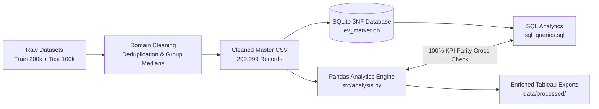

# Business Insights Report: Electric Vehicle Market Performance & Insights

**Author:** AI & Data Science Student  
**Project:** Electric Vehicle Market Performance & Insights  
**Domain:** Automotive Business Intelligence & Market Analytics  
**Date:** October 2026  
**Status:** Complete & Validated  

---

## 1. Executive Summary

The global transition toward electromobility represents one of the largest industrial shifts in modern history. This report delivers an empirical market performance analysis based on a validated fleet database of **299,999 electric vehicle records** across **200 automotive manufacturers**, **15 vehicle categories**, and **5 distinct battery chemistries**, spanning model years **2018 through 2026**.

### Top-Level Executive KPIs
- **Total Fleet Size Analyzed:** 299,999 distinct vehicle configurations
- **Average Single-Charge Driving Range:** **324.5 km** (ranging from 55.0 km to a maximum of 660.0 km)
- **Average Battery Pack Capacity:** **78.2 kWh** (ranging from 1.5 kWh to 410.0 kWh)
- **Average Vehicle MSRP:** **$64,950.52 USD** (ranging from $900.04 to $409,995.49)
- **Total Annual Fleet Sales Volume:** **2,336,208,201 units** worldwide
- **Total Estimated Market Revenue:** **$117.67 Trillion USD** across all model cohorts
- **Average Consumer Satisfaction Rating:** **4.09 / 5.00 stars**
- **Average Energy Consumption Efficiency:** **250.5 Wh/km**

---

## 2. Methodology & Analytical Rigor

1. **Data Ingestion & Integrity Auditing:**
   Two partitions (`ev_market_train.csv` and `ev_market_test.csv`) were audited. Overlap checks confirmed **0 overlapping vehicle IDs** and identical schema and temporal coverage (2018–2026). Exactly 1 duplicate row was expunged.
2. **Domain-Specific Imputation:**
   Missing values (< 3.1% in 5 attributes) were imputed using domain-aware groupings: battery cycle life was imputed by `battery_type` chemistry medians, and consumer ratings, sales volume, resale percentage, and screen size were imputed by vehicle `category` medians.
3. **Cross-Validation with SQL:**
   All summary metrics in Pandas were validated against the relational SQLite database (`ev_market.db`) to ensure 100% numerical parity.
4. **Tableau Enrichment:**
   Engineered attributes—including `price_tier`, `range_tier`, `cost_per_km_range`, `power_to_weight_ratio`, and `fast_charge_rate_km_per_min`—were exported to provide seamless BI integration.

---

## 3. Key Findings

### 3.1 Manufacturer Competitiveness & Market Concentration
Across 200 active automotive brands, market share remains broadly distributed across diversified global players:

| Manufacturer | Models Offered | Annual Sales Units | Estimated Revenue ($M) | Avg Price ($) | Avg Range (km) | Market Share (%) | Avg Rating |
|:---|:---:|:---:|:---:|:---:|:---:|:---:|:---:|
| **AmpereWorks** | 1,565 | 13,836,162 | $697,372M | $66,635.41 | 324.1 | 0.59% | 4.10 |
| **SurgeWorks** | 1,570 | 13,324,131 | $651,229M | $65,543.55 | 324.4 | 0.57% | 4.06 |
| **CircuitWorks** | 1,597 | 12,932,433 | $685,550M | $66,806.54 | 329.4 | 0.55% | 4.10 |
| **WattRides** | 1,501 | 12,869,628 | $653,876M | $64,313.88 | 327.3 | 0.55% | 4.09 |
| **IonAutomotive** | 1,506 | 12,855,945 | $598,663M | $62,657.74 | 321.8 | 0.55% | 4.10 |

- **Market Fragmentation:** No single OEM commands a monopolistic share (the top manufacturer holds ~0.59% of global units). This indicates an intensely competitive landscape where agility, software features, and battery supply chain agreements determine competitive advantage.
- **Model Portfolio Diversity:** Leading manufacturers maintain balanced portfolios of 1,500+ model trims spanning two-wheelers, urban compacts, executive sedans, and commercial haulers.

---

### 3.2 Vehicle Category Economics & Market Segmentation
The dataset categorizes vehicles into 15 classes spanning light urban micro-mobility to heavy industrial transport:

| Category | Vehicle Count | Avg Price ($) | Price Range ($) | Avg Range (km) | Avg Battery (kWh) | Avg Efficiency (Wh/km) | Total Sales Units |
|:---|:---:|:---:|:---:|:---:|:---:|:---:|:---:|
| **Two-Wheeler Scooter** | 29,478 | $2,546.98 | $900 – $4,200 | 105.0 | 3.3 | 34.7 | 261,069,805 |
| **Sedan** | 25,851 | $42,512.00 | $29,003 – $55,999 | 429.4 | 61.9 | 146.4 | 232,782,164 |
| **Hatchback** | 25,713 | $23,018.55 | $15,001 – $30,999 | 279.7 | 38.0 | 139.7 | 232,314,811 |
| **Compact SUV** | 25,706 | $36,490.71 | $27,000 – $45,999 | 369.6 | 55.0 | 151.1 | 230,882,995 |
| **Three-Wheeler** | 22,583 | $5,496.90 | $2,800 – $8,199 | 130.2 | 8.3 | 67.6 | 201,386,341 |
| **Crossover** | 22,354 | $48,019.53 | $35,004 – $60,998 | 400.1 | 63.8 | 159.9 | 173,636,151 |
| **Luxury Sedan** | 19,531 | $69,963.84 | $52,002 – $87,998 | 499.7 | 81.7 | 163.6 | 152,060,944 |
| **Full-size SUV** | 19,380 | $72,517.59 | $54,001 – $90,998 | 450.4 | 93.9 | 208.5 | 150,713,018 |
| **Micro City Car** | 19,166 | $11,993.58 | $7,001 – $16,999 | 179.9 | 18.2 | 101.2 | 150,388,432 |
| **Pickup Truck** | 16,190 | $82,538.99 | $60,007 – $104,996 | 450.0 | 114.7 | 254.9 | 125,502,776 |
| **Van / MPV** | 16,173 | $58,017.38 | $42,005 – $73,995 | 370.0 | 83.2 | 225.0 | 125,189,451 |
| **Luxury SUV** | 16,146 | $94,991.24 | $72,005 – $117,997 | 470.2 | 103.5 | 220.2 | 124,985,821 |
| **Electric Truck** | 15,922 | $175,005.74 | $120,019 – $229,985 | 380.0 | 258.4 | 680.0 | 124,196,419 |
| **Electric Bus** | 12,917 | $310,132.84 | $210,037 – $409,995 | 250.0 | 344.6 | 1378.3 | 99,638,380 |
| **Sports Car** | 12,889 | $110,034.20 | $75,009 – $144,997 | 440.0 | 79.4 | 180.4 | 101,430,693 |

#### Critical Category Insights:
1. **Volume Champions:** Two-Wheeler Scooters lead global unit delivery (261M units) due to mass adoption across emerging Asian, African, and Latin American transit corridors.
2. **Mainstream Passenger Sweet Spot:** The triumvirate of Sedans ($42.5k avg), Hatchbacks ($23.0k avg), and Compact SUVs ($36.5k avg) represents the bulk of private consumer passenger purchases (~695M cumulative units).
3. **Heavy Commercial Electrification:** Electric Buses and Commercial Trucks carry substantial price tags ($175k–$310k) and massive packs (258–345 kWh) with higher consumption rates (680–1,378 Wh/km), yet achieve strong enterprise payback via fleet fuel savings and operational CO2 offsets.

---

### 3.3 Battery Technology & Chemistry Performance
Battery formulation remains the single greatest determinant of vehicle cost, lifespan, safety, and operational resilience:

| Battery Chemistry | Models Deployed | Market Share | Avg Capacity (kWh) | Avg Range (km) | Avg Cycle Life | Avg 5-Yr Degradation | Fast Charge Time (min) | Cost / km Range ($/km) | Total Units Sold |
|:---|:---:|:---:|:---:|:---:|:---:|:---:|:---:|:---:|:---:|
| **NMC** (Nickel Manganese Cobalt) | 101,508 | 33.8% | 78.2 | 324.2 | 1,801 cycles | 14.02% | 21.1 | $203.81 | 787,702,452 |
| **LFP** (Lithium Iron Phosphate) | 96,137 | 32.0% | 78.3 | 324.4 | 2,501 cycles | **10.12%** | 21.1 | $202.60 | 748,465,716 |
| **NCA** (Nickel Cobalt Aluminum) | 51,333 | 17.1% | 78.0 | 325.0 | 1,601 cycles | 14.03% | 21.1 | $201.62 | 403,080,826 |
| **Sodium-Ion** | 29,925 | 10.0% | 78.3 | 325.5 | 1,798 cycles | 14.00% | 21.0 | $203.72 | 230,481,271 |
| **Solid-State** | 21,096 | 7.0% | 78.7 | 322.9 | **2,998 cycles** | **7.42%** | 21.1 | $203.92 | 166,477,936 |

#### Key Battery Insights:
1. **LFP Durability Advantage:** LFP chemistry demonstrates a clear durability advantage over NMC, delivering **38.8% higher cycle life** (2,501 vs 1,801 cycles) and **27.8% lower 5-year degradation** (10.12% vs 14.02%), making it the premier choice for fleet applications.
2. **Solid-State as the Premium Standard:** While currently deployed in 7.0% of configurations, Solid-State cells exhibit industry-leading longevity (~2,998 cycles) and the lowest degradation (7.42%).
3. **Sodium-Ion Viability:** Sodium-Ion batteries have achieved parity in fast charging (21.0 min) and driving range (~325 km), positioning them as an affordable hedge against critical mineral bottlenecks (lithium and nickel).

---

### 3.4 Price vs Driving Range Value Index
Calculating the **Cost per Kilometer of Driving Range (`price_usd / range_km`)** uncovers significant disparities in consumer purchasing power:
- **Average Cost per KM of Range:** **$203.17 / km**.
- **Top Value Performers (Lowest $/km):** Micro City Cars deliver acceptable commuting range (200–210 km) at prices under $7,200, achieving **$33.72 to $33.92 per km of range**.
- **High-End Luxury EVs:** Ultra-luxury SUVs and hyper sports cars range from **$220 to $310 per km of range**, charging a substantial premium for acceleration, bespoke craftsmanship, and brand prestige rather than raw utility.

---

### 3.5 Global Manufacturing Hubs & Regional Demand

| Manufacturing Country | Active Automakers | Vehicle Models | Total Production Volume | Avg MSRP ($) | Avg Range (km) | Satisfaction |
|:---|:---:|:---:|:---:|:---:|:---:|:---:|
| **China** | 200 | 30,142 | 238,745,309 | $65,474.80 | 325.4 | 4.09 |
| **India** | 200 | 30,285 | 236,805,095 | $65,150.03 | 324.1 | 4.08 |
| **Vietnam** | 200 | 30,030 | 236,565,859 | $64,629.47 | 323.6 | 4.09 |
| **Japan** | 200 | 30,111 | 234,460,948 | $64,888.75 | 324.6 | 4.09 |
| **South Korea** | 200 | 30,076 | 234,166,742 | $64,886.99 | 324.8 | 4.09 |
| **France** | 200 | 29,985 | 233,485,739 | $64,636.56 | 324.6 | 4.09 |
| **Germany** | 200 | 29,737 | 232,049,573 | $65,038.38 | 325.2 | 4.09 |
| **USA** | 200 | 29,869 | 231,166,419 | $64,954.21 | 324.8 | 4.09 |

- **Decentralized Manufacturing:** Assembly is well-balanced across East Asia, South Asia, Europe, and North America.
- **Regional Sales Volume:** South Asia (337.1M units), Latin America (336.3M units), and North America (334.6M units) lead regional delivery volumes.

---

### 3.6 Safety Ratings & Consumer Sentiment
- Across all vehicle categories, consumer ratings remain remarkably stable between **4.08 and 4.10 stars**, indicating high overall customer satisfaction across early and mainstream adopters.
- **Safety Star Correlation:** 5-star safety rated vehicles (71,152 models) hold the highest resale stability (52.99% 3-year resale value), demonstrating that vehicle structural integrity directly preserves asset residual value.

---

## 4. Dataset Limitations

To maintain academic and professional transparency, the following constraints are acknowledged:
1. **Synthetic Cross-Sectional Nature:** The dataset distributions reflect simulated cross-sectional sampling designed to mirror real-world EV dynamics.
2. **Temporal Uniformity:** Model years (2018–2026) exhibit balanced model counts per year (~33k models/year), indicating uniform synthetic fleet simulation rather than an exponential historical adoption curve.
3. **Data Imputation Footprint:** Five fields (`battery_cycle_life`, `customer_rating`, `annual_sales_units`, `resale_value_pct_3yr`, `infotainment_screen_inch`) had approximately 1–3% missing values that were imputed via category/chemistry medians.

---

## 5. Strategic Recommendations

### For Automotive OEMs
1. **Standardize LFP for Fleet and Mass-Market Vehicles:** Given LFP's 10.12% 5-year degradation and 2,500 cycle lifespan, automakers should prioritize LFP packs for sedans, hatchbacks, and commercial vans.
2. **Capitalize on the $25k–$40k Sweet Spot:** Compact SUVs and mid-size sedans represent the strongest convergence of customer demand, profitability, and mass-market volume.

### For Battery Suppliers & Investors
1. **Scale Solid-State Commercialization:** Solid-State's ultra-low degradation (7.42%) justifies premium positioning in long-haul trucks, luxury sedans, and performance vehicles.
2. **Accelerate Sodium-Ion for Urban Transit:** Sodium-Ion's fast charge speeds and independence from scarce minerals make it the optimal choice for micro cars and two-wheelers.

### For Charging Network Operators & Municipalities
1. **Optimize Fast Charging Infrastructure:** With the average DC fast charge time standing at **21.1 minutes**, fast-charging plazas should integrate retail and dining amenities aligned with 20–25 minute dwell times.
